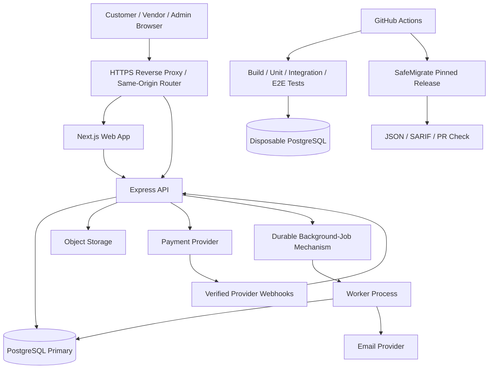

# 02 — System Architecture and Technology Decisions

**Status:** Proposed baseline for sign-off  
**Architecture goal:** One maintainable marketplace and one independent migration analyzer, joined through a versioned CI integration.

## 1. Repository strategy

Maintain **two separate Git repositories**:

- `flashcart`: marketplace web app, API, database migrations, tests, deployment/operations files and integration workflows.
- `safemigrate`: Python package/CLI, PostgreSQL rules, fixtures, analyzer tests, report format definitions, docs and releases.

A local workspace may contain sibling checkouts (`workspace/flashcart` and `workspace/safemigrate`) for development. This is not a monorepo. FlashCart consumes a pinned SafeMigrate release or versioned action/container; production behavior must not depend on an unpinned development branch.

## 2. Technology decisions

| Concern | Decision | Reason/constraint |
|---|---|---|
| Web | Next.js App Router, React, TypeScript | Storefront pages, routing, metadata/SEO and interactive buyer/vendor/admin interfaces |
| API | Node.js 24 LTS, TypeScript, Express | Mature HTTP API ecosystem; separate service boundary; pin patch/runtime in CI and deployment |
| Database | PostgreSQL 18.x at the supported patched minor available during environment creation | ACID transactions, constraints, row locks, mature migration and query-plan tooling |
| SQL access | `pg`/node-postgres with SQL held in repository/service modules | Critical checkout locking, isolation and transaction boundaries remain explicit and reviewable |
| Migrations | `node-pg-migrate`, versioned files in Git | Repeatable schema changes with a tracked migration history; transaction restrictions must be explicit for special DDL |
| Validation | Runtime request-schema validation (Zod or an equivalent single chosen library) | TypeScript types alone do not validate untrusted HTTP payloads |
| Authentication | Secure, server-managed sessions in PostgreSQL with opaque session cookies | Avoid storing long-lived bearer credentials in browser local storage; use same-origin API routing to simplify cookies/CSRF |
| Images | S3-compatible object storage or managed object storage | DB stores image metadata/object key, not binary image files |
| Tests | Vitest or Jest for TS tests; Playwright for browser flows; real PostgreSQL integration tests; k6 for controlled load tests | Separate fast logic tests from real database behavior and browser acceptance |
| CI | GitHub Actions | Reproducible builds, database tests, SafeMigrate scanning, artifact retention |
| SafeMigrate | Python 3.12+ baseline, SQLGlot PostgreSQL dialect, Typer CLI, Rich terminal output | AST-aware SQL inspection with a lightweight installable CLI; exact dependencies pinned and tested |
| Output integrations | JSON and SARIF for SafeMigrate | Human-readable local reports plus machine-readable CI/security findings |

Version policy: pin runtime major versions, lock application dependencies, use supported security patches, and update dependencies through reviewed pull requests. PostgreSQL 18 is currently a supported major; verify the official release policy when creating deployment images. Node 24 is an LTS line; use an exact current patch in `.nvmrc`/toolchain config and CI.

References: [Node.js release schedule](https://github.com/nodejs/Release#release-schedule), [PostgreSQL versioning policy](https://www.postgresql.org/support/versioning/), [Next.js documentation](https://nextjs.org/docs), [SQLGlot](https://sqlglot.com/).

## 3. Logical architecture

## 4. Deployment topology

Start with the simplest production topology that meets measured reliability requirements:

- HTTPS entry point and one public origin (for example, `shop.example` with `/api` proxied to the API service).
- Web service and API service can be deployed separately but are routed under the same public origin.
- Managed PostgreSQL with automated backups and point-in-time recovery where the selected plan supports it.
- Private environment networking for database connections; DB is not exposed directly to the public internet.
- Object storage for product images with controlled upload and serving permissions.
- Separate staging and production environments with separate databases, credentials, payment keys and storage buckets.
- A worker process may initially run as a separate container from the same codebase. It must use durable jobs/outbox records for business-critical work, not depend on an in-memory queue.

Docker Compose is the standard local developer/test topology. Production provider selection is a separate documented decision after pricing, region, commercial terms, backup capability and operational constraints are verified. Do not commit secrets into Compose files or `.env` examples.

## 5. Boundaries and ownership

- **Web:** presentation, form state and display. Never authoritative for price, roles, sale limits or inventory.
- **API:** authentication, authorization, orchestration, input validation and public contract.
- **Domain services:** checkout, reservation, order state, payment orchestration, refund and vendor ownership rules.
- **Repositories:** SQL and database access. Checkout SQL explicitly defines transaction order and row-lock order.
- **PostgreSQL:** final integrity enforcement via constraints, unique keys and transaction isolation/locking.
- **Payment adapter:** provider-specific API/webhook details; domain code uses internal normalized states.
- **SafeMigrate:** parses/analyzes migration files and emits findings. It does not execute migrations or edit production databases.

## 6. Transaction and async design

- Keep DB transactions focused and bounded. Do not wait on external payment API calls while holding inventory locks.
- Use consistent ascending `product_id` lock order when reserving several products to reduce deadlock risk.
- Persist a checkout/order/payment state transition and an outbox/job record atomically when an async side effect must not be lost.
- Workers claim jobs safely, retry transient failures with bounded backoff, and use idempotency keys/deduplication.
- Use provider webhooks as an input requiring authentication, replay protection and idempotent processing; do not blindly trust client redirects.
- Retry serialization/deadlock errors only around transactions known to be safe to retry and with a bounded retry policy.

## 7. Security and network boundaries

- Public browser traffic reaches only the HTTPS edge.
- API connects to PostgreSQL using an application role with only required privileges; migration role is separate.
- CI migrations run against disposable databases, not production credentials.
- Production migration execution uses a separate authorized release step and backup/health checks.
- Secrets are loaded from environment/secret manager, never stored in Git or output in logs.
- Admin endpoints are protected by server role checks and audit logging.

## 8. Scaling policy

Do not add a technology solely to demonstrate it. Add it after a requirement, risk or measurement justifies it:

1. Baseline: PostgreSQL, app/API, object storage, durable job table/outbox.
2. Add Redis if rate limiting, caching or live pub/sub needs it and invalidation semantics are tested.
3. Add a database read replica if read traffic and measured primary load justify it; checkout and authoritative stock checks stay on primary.
4. Consider partitioning after query plans and table growth show a need.
5. Consider a dedicated queue, additional API replicas, CDN and container orchestration after operational benefit exceeds cost.
6. Consider a document database only for a clearly justified data model/use case, not as a required architectural ornament.

## 9. Failure handling

- Database unavailable: fail closed for checkout; never confirm purchase based solely on a cache.
- Payment provider timeout: retain a pending/reconcilable state; lookup provider status before releasing/confirming ambiguous payments.
- Duplicate webhook: record provider event identity and return a safe acknowledgement after idempotent handling.
- Object storage error: product pages show a controlled placeholder; image upload failures do not publish broken references.
- Worker unavailable: durable jobs remain pending and alert on age/volume.
- Migration preflight failure: stop deployment; do not automatically attempt dangerous rollback.

## 10. Architecture decisions to record

Each decision record should contain ID, status, context, decision, alternatives, consequences, owner and date. Initial records: ADR-001 two repositories; ADR-002 PostgreSQL source of truth; ADR-003 explicit SQL for checkout; ADR-004 same-origin cookie session model; ADR-005 external payment outside inventory transaction; ADR-006 pinned SafeMigrate integration; ADR-007 no added scaling component without evidence; ADR-008 no production launch without restore rehearsal and payment-provider approval.
