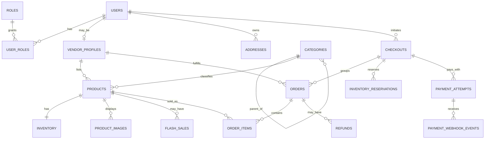

# 03 — Database, Transactions and Migration Design

**Status:** Proposed baseline for sign-off  
**Primary database:** PostgreSQL 18.x  
**Core objective:** Enforce marketplace invariants in the database and create realistic migrations for SafeMigrate to analyze.

## 1. Design rules

- PostgreSQL is the authoritative source for inventory, order and payment state.
- Use integer minor currency units plus a currency code; do not use floating-point money.
- Use foreign keys, unique constraints, CHECK constraints and transaction boundaries where they express business invariants.
- Store timestamps as `timestamptz` in UTC; render in the user's chosen/display timezone.
- Avoid assuming that one SQL statement always causes a table rewrite or outage. Lock/rewrite behavior depends on the operation, server version, table shape and execution context.
- Store no payment-card secrets or authentication tokens in general business tables.

## 2. Entity relationship outline

## 3. Logical tables and critical fields

The implementation may adjust naming to follow project conventions, but table ownership and invariants below are locked.

### Identity and catalog

- `users`: `id`, normalized unique `email`, `password_hash`, verification/active flags, timestamps.
- `roles`: stable role keys; `user_roles`: many-to-many mapping so the same user can shop and sell.
- `vendor_profiles`: `id`, `user_id` unique FK, public store name, approval status, timestamps.
- `addresses`: user-owned address records with soft deletion or active flag; checkout snapshots the selected shipping address so later edits don't rewrite an existing order.
- `categories`: parent self-FK, slug/name, active status.
- `products`: vendor FK, category FK, slug, SKU unique, title/description, `price_minor`, `currency`, status, timestamps.
- `product_images`: product FK, object key, alt text, sort order and status; do not put binary files in PostgreSQL.
- `inventory`: one row per product; `on_hand_qty`, `reserved_qty`, version/timestamps. Enforce `on_hand_qty >= 0`, `reserved_qty >= 0`, and `reserved_qty <= on_hand_qty` if `on_hand_qty` means physical units currently present. Alternatively model available/on-hand carefully, but select one clear definition and test it.
- `flash_sales`: product FK, start/end, sale price, quantity cap, quantity reserved and quantity sold; enforce a valid window, nonnegative quantities, and `quantity_reserved + quantity_sold <= quantity_limit`.

### Checkout, order and payment

- `carts`, `cart_items`: cart owner and one cart row per product; quantity positive. Cart contents are advisory until checkout validation.
- `checkouts`: one customer checkout attempt/aggregate, currency, server-calculated totals, status, idempotency key/hash, created/updated timestamps.
- `orders`: one sub-order per vendor under a `checkout_id`; includes vendor, customer, shipping-address snapshot, totals and controlled order status. A unique constraint on `(checkout_id, vendor_id)` prevents duplicate vendor sub-orders within one checkout.
- `order_items`: order/product references, SKU/name/price/currency snapshots, quantity and totals. Product title/price changes later must not rewrite historical order values.
- `inventory_reservations`: checkout/order-item/product reference, quantity, optional flash-sale reference, expiry, status and timestamps. This is the authoritative reservation ledger.
- `payment_attempts`: checkout reference, provider, provider payment/reference IDs, amount/currency, normalized status, idempotency identity, timestamps. Never store card PAN/CVV.
- `payment_webhook_events`: unique `(provider, provider_event_id)`, received/processed status, safe minimal payload/hash, processing timestamps and error code. Store only required data, protect it and define retention.
- `refunds`: payment/order references, amount, provider refund ID, idempotency identity and status.
- `order_status_history`: order, old/new status, actor/system cause, timestamp and safe metadata.
- `audit_log`: actor, action, target type/id, timestamp, request/correlation ID and redacted before/after fields.
- `outbox_jobs` (or an equivalently durable queue table): event/job type, payload with no secrets, status, attempt count, next attempt, lock/lease and creation timestamps.
- `sessions`, `password_reset_tokens`/verification tokens: store hashed secret/token values and expiry/revocation metadata; never store reusable plaintext reset tokens.

## 4. Inventory semantics

Define semantics before creating tables:

- `on_hand_qty`: units physically held and not yet permanently removed by a completed sale; returned items affect this only after a defined return/restock decision.
- `reserved_qty`: units temporarily committed to valid, unexpired pending checkouts.
- available-to-reserve units = `on_hand_qty - reserved_qty`.
- `flash_sales.quantity_limit` is the maximum quantity eligible for that particular sale, independent of total product stock.
- `quantity_sold + quantity_reserved` for that sale may never exceed the sale limit.

All inventory changes go through a small set of tested domain operations. No endpoint may decrement quantities with an ad hoc update that bypasses reservation/accounting logic.

## 5. Checkout transaction protocol

Never call the payment provider inside the transaction holding inventory row locks.

### Phase A — create checkout and reserve

1. Authenticate the customer; require a valid, unique idempotency key for the checkout attempt.
2. Load current product prices, sale times, sale caps and customer/cart data on the server.
3. Determine all affected product IDs and acquire locks in ascending `product_id` order. Lock associated active sale rows in a documented deterministic order too.
4. Revalidate product publication, price, sale time, requested quantity, warehouse available quantity and sale-specific remaining quantity.
5. Create/resolve one aggregate checkout and one vendor sub-order per vendor; persist immutable order-item snapshots.
6. Atomically increase reserved quantities and sale reserved counts, and create reservation rows with an expiry. Conditional updates/constraints should make invalid transitions fail even if application checks are wrong.
7. Create a pending payment attempt and the required durable outbox/operation record.
8. Commit. Return an internal checkout/payment initiation state, not a claim that payment is complete.

Exact lock statements/updates must be designed with the selected schema and covered by integration tests. Row locking alone does not solve every bug: duplicate requests, multi-row lock order, sale cap accounting and reservation expiry also need explicit treatment.

### Phase B — provider payment

1. Create/initiate the provider payment using a stable idempotency identity where the provider supports it.
2. Do not trust only a client redirect/query parameter.
3. Verify provider webhooks (signature, timestamp/replay policy and event identity) and/or query provider state for ambiguous cases.
4. Persist provider event ID before/with idempotent state processing, using one transaction.

### Phase C — finalize success

- Lock checkout, payment, reservation and relevant inventory/sale rows in the established order.
- If the payment event was already processed, return safely with no duplicate effects.
- If success is valid and the reservation remains valid, reduce `reserved_qty`, reduce physical `on_hand_qty` by sold quantity according to the chosen inventory semantics, reduce sale `quantity_reserved`, increase sale `quantity_sold`, mark reservations consumed, and transition orders/checkout/payment to their final states atomically.
- If a provider reports success after reservation expiry, do not blindly oversell. Run a defined reconciliation path: attempt a fresh safe reservation if policy permits, otherwise refund/void and alert.
- Insert audit/outbox events in the same transaction when needed.

### Phase D — payment failure or expiry

- A failed/expired payment releases reservation quantities once; unique state transitions prevent double release.
- Update sale reservation counts consistently.
- Mark order/checkout/payment states, produce notifications through durable jobs, and preserve an auditable record.
- Expiry workers must claim due reservations safely and be idempotent; run a reconciliation process for stuck reservations/payment states.

## 6. Isolation, locking, deadlocks and retries

- Default transaction isolation is selected deliberately; start with PostgreSQL `READ COMMITTED` plus explicit row locks/conditional updates for the reservation invariant, then prove the implementation with concurrency tests.
- Lock multiple product/inventory rows in deterministic sorted order to reduce deadlocks.
- Handle PostgreSQL serialization/deadlock codes narrowly and retry only safe whole-transaction units with a bounded backoff.
- Never retry a payment side effect blindly. External-provider idempotency and reconciliation are separate from database transaction retry.
- Keep locks short. Do not perform image fetches, email sending, analytics calls or payment HTTP requests while holding inventory locks.

## 7. Indexes and query planning

Initial index candidates, to be validated with `EXPLAIN (ANALYZE, BUFFERS)` against representative data:

- Unique normalized user email and product SKU.
- Product listing filters: category/status plus the actual price/sort pattern, only if a matching index measurably helps.
- Vendor product list keyed by vendor/status/created time.
- Order history keyed by customer/created time; vendor orders keyed by vendor/status/created time.
- Reservation expiry lookup for pending reservations.
- Unique provider webhook event identity and payment provider reference.
- Full-text search only after search semantics and data size are known.

Do not promise the planner will always use an index; record the plan and benchmark environment. Partial-index predicates must be immutable where PostgreSQL requires that—for example, a predicate directly depending on `now()` is not a valid simple partial-index predicate. Use a stable predicate such as row status and query appropriate time conditions separately.

## 8. Migration discipline

- Every schema change is a versioned migration committed with code that depends on it.
- Apply migrations to a clean disposable database in CI and to a representative pre-existing schema for upgrade tests.
- Test compatibility across a deployment window when the release can run old and new application instances simultaneously.
- Prefer expand-contract for breaking changes: add compatible schema, deploy code that can work with old and new schema, backfill in bounded batches, switch reads/writes, observe, then remove the old schema in a later release.
- Large backfills are resumable, rate-limited and observable. Do not hide them in one migration transaction by default.
- `CREATE INDEX CONCURRENTLY` has transaction-context restrictions; ensure the migration runner configuration is compatible, and test actual behavior.
- A `down` migration existing in source does not mean it is safe to run in production. Classify rollback feasibility and data-loss risk. For destructive or post-write changes, a forward fix/restore plan may be safer than automatic rollback.
- Keep a production migration role separate from the runtime application role.

## 9. SafeMigrate integration points

FlashCart migrations must include representative safe and risky fixtures so rules are exercised over time. CI runs SafeMigrate in advisory mode first, then policy-enforced mode after rule accuracy is established.

Initial target rule examples: destructive `DROP TABLE`/`DROP COLUMN`; non-concurrent index creation with contextual uncertainty; concurrent index creation in a transaction-wrapped migration; type changes whose lock/rewrite behavior is operation-specific; adding/validating constraints; and large unbounded updates. Findings include file/line, rule ID, severity, confidence, rationale and suggested next action.

SafeMigrate must not execute these files. Actual migrations run only through the separate migration workflow and disposable/test database harness.

## 10. Database acceptance tests

- All FK/unique/check constraints are tested, including attempted invalid writes.
- Cart can include multiple vendors and generates one sub-order per vendor without duplicate payment/checkout effects.
- Inventory and sale cap survive concurrent reservations, confirmation, expiry and retries.
- Duplicate webhooks and checkout retries are idempotent.
- Expired reservation plus late successful payment follows documented reconciliation policy.
- Clean install, upgrade from the previous schema and tested operational recovery procedure pass in CI/staging.
- Query plans and benchmark data are retained for material index changes.
